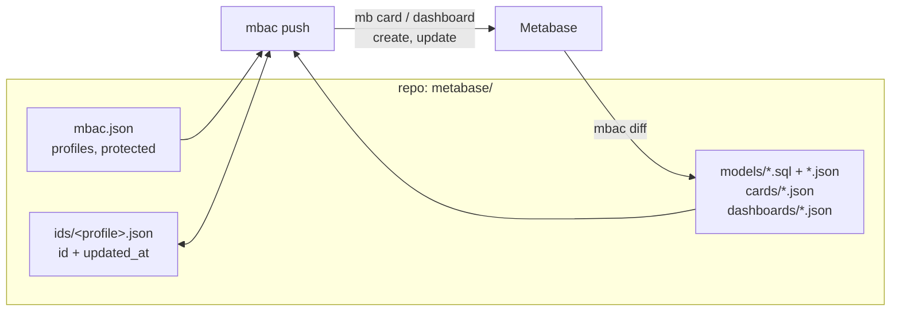
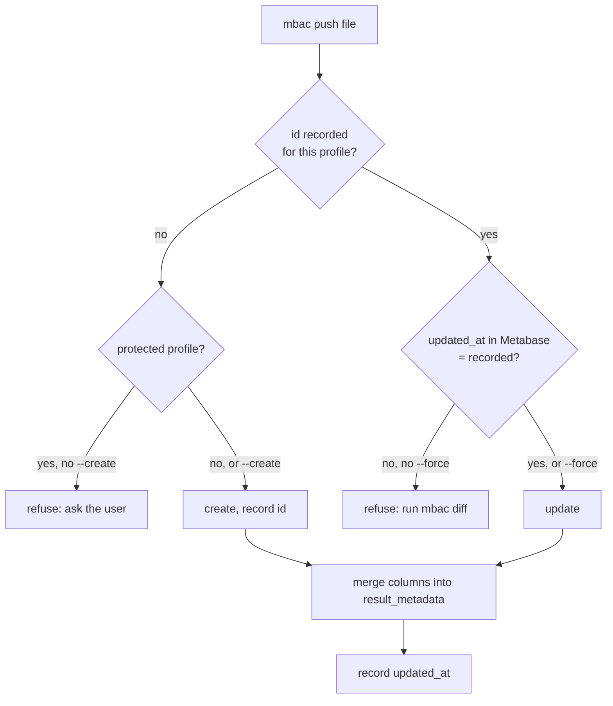

# metabase-as-code: Metabase as Code for AI Agents

A Claude Code skill that makes AI agents keep Metabase cards, models and dashboards as files in a repo and deploy them
with the official [`mb` CLI](https://github.com/metabase/metabase-cli), instead of clicking or calling the API until
the content exists only inside Metabase.

> **Version 0.1.0**: first release. One skill, `metabase-as-code`, with its push tool `mbac`. See [CHANGELOG](#changelog).

## Why This Skill?

This skill **changes how an agent builds Metabase content**. It is not a reference for the Metabase API. It redirects
the agent's default habit and gives it one tool to do the right thing.

**The Problem:** Asked to "make a dashboard", an agent with `mb` installed does the shortest thing:

- **Direct writes**: `mb card create`, `mb dashboard create`, one after another. The result lives only in Metabase:
  no review, no history, no way to rebuild it on another instance.
- **Lost ids**: the next session does not know which card belongs to which piece of work, so it creates duplicates.
- **Clobbered UI edits**: a colleague changes a title in the UI; the next scripted update overwrites it silently.
- **Wrong environment**: `mb` prefers `MB_URL`/`MB_API_KEY` from the shell over `--profile`, so a "local" push can
  land in production.
- **Reinvented scripts**: told to "do it the repo way", the agent writes yet another push script with its own
  placeholder rules.

**The Solution:** one skill and one tool.

- **metabase-as-code** redirects from direct writes → definitions in the repo, pushed by `mbac`
- `mbac` resolves placeholders (`"@card:models/orders.json"`, `"@table:PUBLIC.ORDERS"`) per profile, records ids,
  refuses to create on protected profiles without `--create`, and refuses to overwrite UI edits without `--force`

## Background & Motivation

The workflow comes from a project that rebuilt cost-analysis reports on Metabase with Claude Code. Its repo held the
SQL and card definitions; two shell scripts pushed them with `mb`. It worked, and each rule in it came from an incident
(a card created in production by a stray `MB_URL`, column descriptions lost because `result_metadata` was null, a pivot
setting silently ignored).

The catch: agents only followed it when the prompt spelled it out, and in a new folder they wrote their own push script
from scratch. This repo turns the workflow into a skill that triggers on its own, and the two scripts into one tested
tool.

## Available Skills

### metabase-as-code

**Instead of** creating content directly in Metabase, write it as files and push it. This skill:

- Sets up a content root (`metabase/` with `mbac.json`, `collections.json`, `models/`, `cards/`, `dashboards/`)
- Writes native SQL as `.sql` + `.json`, MBQL questions and dashboards as `.json`, with placeholders instead of ids
- Pushes with `mbac push` (single files, or `--all` in dependency order) and verifies by running the cards
- Asks before creating anything on a protected (production) profile
- On "changed in Metabase since the last push", runs `mbac diff`, merges the UI edit into the repo, then `--force`
- Carries a list of Metabase settings that fail silently, with what to do instead

Use it whenever an agent builds or changes Metabase cards, models or dashboards. It triggers on its own for requests
like "make a Metabase dashboard for X" or "push this to Metabase". For reading data or admin settings, the official
`metabase-cli` skill remains the right one.

## Installation

Install via npx:

```bash
npx skills install humorless/metabase-as-code
```

This installs one skill: `metabase-as-code`.

## Quick Start

### 1. Install and log in to the `mb` CLI

`mb` needs Node.js 20.6 or later. `mbac` runs on the same Node.

```bash
npm install -g @metabase/cli
mb auth login --profile local      # asks for the Metabase URL and an API key
mb auth status --profile local
```

### 2. Ask for what you want

In Claude Code:

```text
Make a Metabase dashboard on the local instance (profile local): revenue by category as bars,
orders per month as a line, and clicking a bar filters the line.
```

The agent creates `metabase/`, writes the definitions, pushes them and gives you the dashboard URL.

### 3. Or drive `mbac` yourself

```bash
MBAC="node ~/.claude/skills/metabase-as-code/scripts/mbac.mjs"   # wherever the skill is installed
$MBAC init --profile local --database "Sample Database"
$MBAC status
$MBAC render metabase/cards/revenue_by_category.json   # body with placeholders resolved, nothing written
$MBAC push --all
$MBAC diff metabase/dashboards/overview.json           # repo vs Metabase
```

## How It Works





**Typical workflow:**

1. `mbac status` to see what is deployed and what changed in the UI
2. Edit or add definitions; `mbac render` and `mb query` to try them
3. `mbac push` to a non-protected profile, run the cards, check the numbers
4. With the user's go-ahead, push to the protected profile
5. Commit the definitions and `ids/<profile>.json`

## Validation

- **`mbac`**: 9 tests against a fake `mb` (`npm test`) cover placeholder resolution, dependency order, the
  protected-profile and UI-edit guards, `MB_URL` removal, column metadata and cycle detection.
- **Live run**: pushed models, MBQL questions on a model, and two dashboards linked by click behavior to Metabase
  0.61.3 (open source, Sample Database). The UI-edit guard and `diff` were checked the same way.
- **Behavior evals**: three with/without-skill scenarios in
  [`skills/metabase-as-code/evals/evals.json`](skills/metabase-as-code/evals/evals.json). Results will be reported
  here once they have run.

## Design Philosophy

- **Repo first**: Metabase shows the deployed result; definitions, ids and history live in git.
- **Names, not ids**: definitions refer to files, tables and columns by name; ids differ per instance and are resolved
  at push time.
- **Refuse rather than guess**: unknown profiles, creating on protected profiles, and overwriting UI edits all stop
  with a message saying what to do next.
- **One tool, no dependencies**: `mbac` is a single Node script that only calls `mb`.

## Changelog

### 0.1.0 Release (2026-11-25)

- **metabase-as-code**: [v0.1.0](./skills/metabase-as-code/CHANGELOG.md)
  - Initial release: skill, `mbac` (`init`, `status`, `render`, `diff`, `push`), format reference, pitfall list,
    tests

## Credits

- **Metabase CLI** (`mb`) by Metabase: <https://github.com/metabase/metabase-cli>
- **clj-native-agent**, whose structure this repo follows: <https://github.com/humorless/clj-native-agent>
