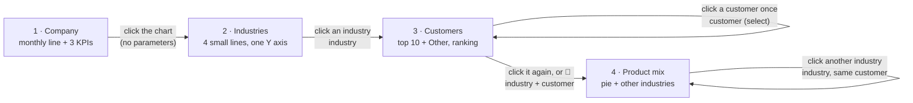

# Example: a guided drill path

Four Metabase dashboards linked into a fixed drill path, **company → industry → customer → product mix**, kept as files
and pushed with `mbac`. It is the largest thing in this repo built with the skill, and a good prompt to try the skill
on: [PROMPT.md](PROMPT.md).



## Try it

You need the `mb` CLI logged in to a Metabase that has the Sample Database (any 0.58 or later; this was run on
0.61.3).

```bash
mb auth login --profile local          # or edit mbac.json to use a profile you already have
cd examples/drill-path/metabase
node ../../../skills/metabase-as-code/scripts/mbac.mjs push --all
```

Open the `dashboards/company.json` URL it prints and click down. To see the skill do it from scratch instead, copy
[PROMPT.md](PROMPT.md) into Claude Code in an empty folder.

`ids/` is not committed here: every reader pushes to their own Metabase, so the ids are theirs.

## What is in `metabase/`

| File | What it is |
| --- | --- |
| `models/shipments.sql` + `.json` | Model: one row per order line, with industry, customer, product and units, and column descriptions |
| `cards/kpi_*.json`, `cards/company_units_by_month.json` | Layer 1: MBQL questions on the model |
| `cards/industry_*.json` | Layer 2: one MBQL line per industry, all with `graph.y_axis.max` 1200 |
| `cards/customers_trend.sql` + `.json` | Layer 3: top 10 customers per quarter, the rest as Other on the right axis |
| `cards/customer_ranking.sql` + `.json` | Layer 3: every customer, ★ on the selected one, and the dashboard its name links to |
| `cards/product_mix.sql`, `cards/customer_industries.sql` | Layer 4: the pie and "This customer also ships to" |
| `dashboards/*.json` | The four dashboards: layout, filters, click behavior, breadcrumbs |

## How each requirement was met

| Requirement | Metabase feature | Native? |
| --- | --- | --- |
| Layer 1 → 2 without parameters | Dashcard click behavior: link to dashboard, empty `parameterMapping` | Yes |
| Layer 2: same Y axis on every industry | `graph.y_axis.auto_range: false`, `min` 0, `max` 1200 on each of the four cards | Partly: Metabase has no shared axis across cards, so the maximum is fixed by hand (the busiest month is 1,127 units) |
| Layer 2 → 3 with the industry | Click behavior: link to dashboard, `industry` ← column `INDUSTRY` | Yes |
| Layer 3: top 10 + Other | Native SQL with `DENSE_RANK`; Other on the right axis (`series_settings`) since it is about 100 times larger | SQL |
| Layer 3: first click highlights | Clicking a customer in the table or a line sets the `customer` filter; the table marks that row ★ and highlights it (`table.column_formatting`) | Yes (cross-filter / link) |
| Layer 3: second click on the same customer drills | The ranking SQL returns `NEXT_DASHBOARD`: layer 3 for an unselected customer, layer 4 for the selected one. The customer name links to `/dashboard/{{NEXT_DASHBOARD}}?...` | Workaround: Metabase has no click state, so the data decides where the click goes. Works in the table only, not on the line |
| Layer 3: 🥧 drills directly | Per-column click behavior on the 🥧 column: link to layer 4 with `industry` and `customer` | Yes |
| Layer 4: switch to another industry of the same customer | Per-column click behavior on `INDUSTRY`: link to the same dashboard, `industry` ← column, `customer` ← current filter | Yes |
| Breadcrumbs | Text cards with `{{industry}}` / `{{customer}}` variables mapped to the filters, linking to the earlier layers | Yes |

Data choices: the Sample Database has no industries or shipments, so an order line is a shipment, the product category is
the industry, and the person who ordered is the customer (see PROMPT.md). Layer 3 is by quarter, not by month: each
customer has only a few orders per industry, and monthly lines were mostly empty.

## Verification

Checked on Metabase 0.61.3 (open source) through `mb`:

- `mbac push --all` created 1 collection, 13 cards and 4 dashboards in one run.
- Every card ran and returned rows (layer 3 and 4 cards with their default filters: Widget, Ted Weber).
- `mbac diff` showed no difference for any card or dashboard after the push, so Metabase kept the click behavior,
  text card mappings, axis and formatting settings.

Then clicked through in a browser:

- Layer 1, the KPIs and the click to layer 2 work; layer 2 shows the four industries on one 0–1,200 axis, and a click
  opens layer 3 with `?industry=...`; the breadcrumbs fill in the industry.
- Selecting a customer on layer 3 broke the top 10 chart: its SQL selected and grouped by a `CASE` holding
  `{{customer}}`, which H2 rejects once the variable has a value (see pitfalls). The card had only been run without a
  customer. Fixed by grouping in an outer query; checked with `industry=Gadget, customer=Trisha Hoeger`: the chart
  returns her line, and the ranking marks her ★ with `NEXT_DASHBOARD` = layer 4.
- After the fix: the selected customer's row is highlighted with ★; both a second click on her name and a click on
  🥧 open layer 4 for `Gadget, Trisha Hoeger` with its pie, the breadcrumb back to Gadget, and ★ on Gadget under
  "This customer also ships to"; clicking Widget there switches the pie to her Widget mix (60 units) and moves the ★.
- Small things seen and fixed: `column_title: ""` on the ★ column was ignored (the header read SELECTED), so the
  title is now ★; the layer 4 header card was taller than its one line of text.

## What the run changed in the skill

- `mbac push` now creates empty dashboards before it pushes cards, so the ranking SQL can name a dashboard id
  (`@@dashboard:dashboards/product_mix.json@@`). Before, that card could not be pushed on a fresh instance.
- `mbac diff` ignores the `lib/uuid` keys Metabase adds to MBQL clauses; every MBQL card showed as changed before.
- New pitfalls on H2: a `{{variable}}` inside a CTE that a second CTE reads returned 0 rows without an error; an
  expression holding a `{{variable}}` cannot be both selected and grouped by.
